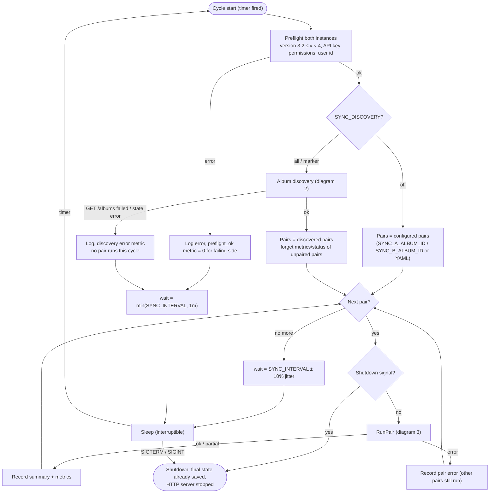
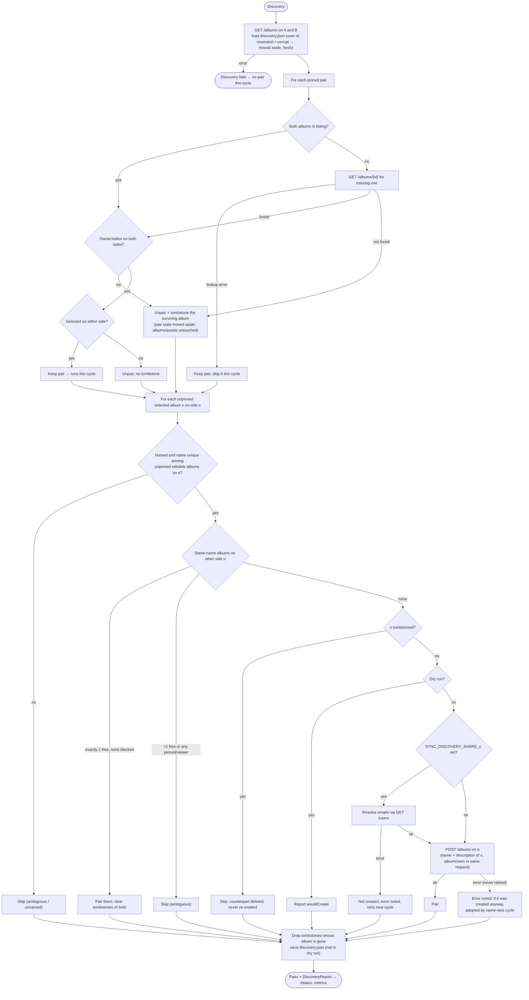
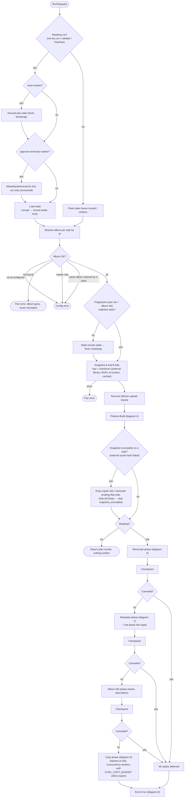
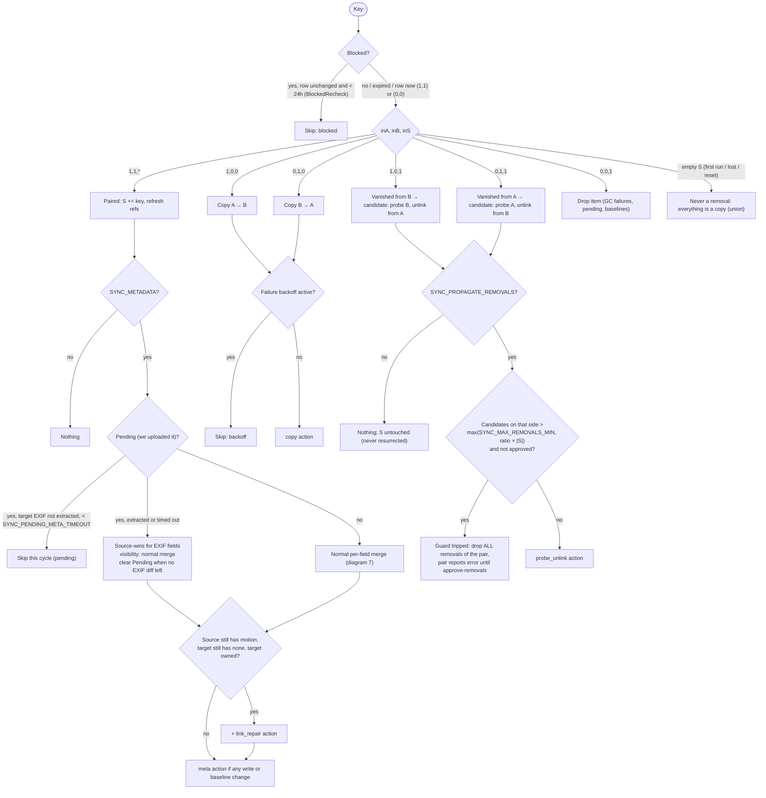
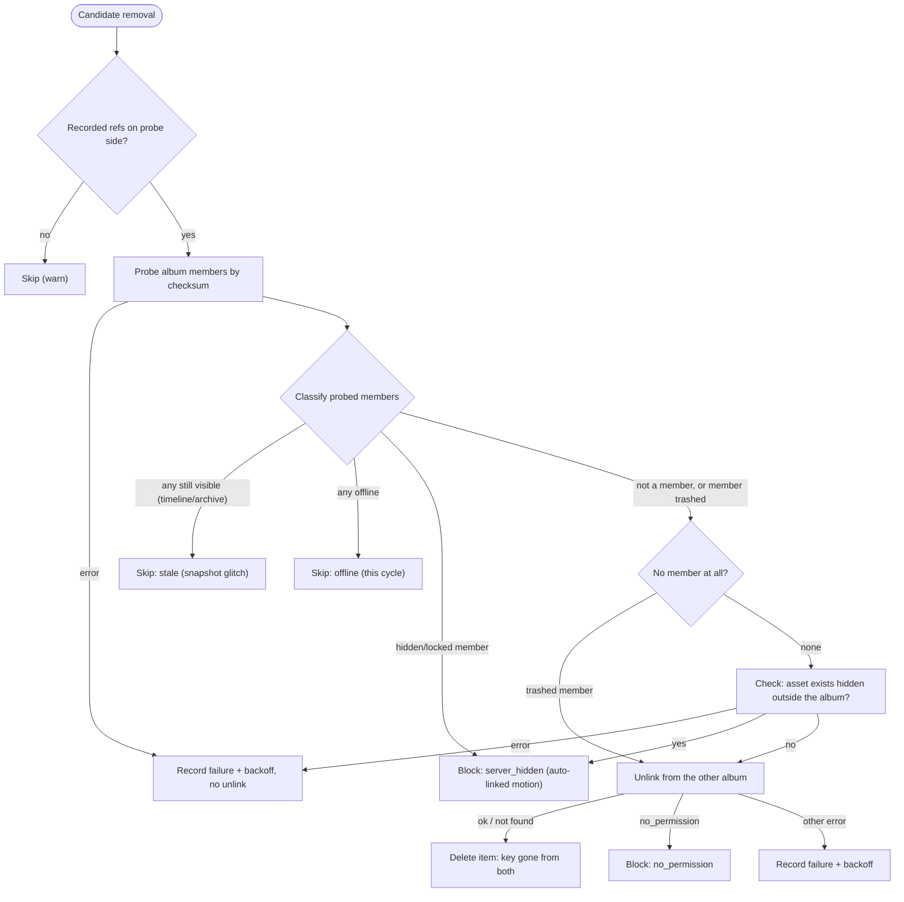
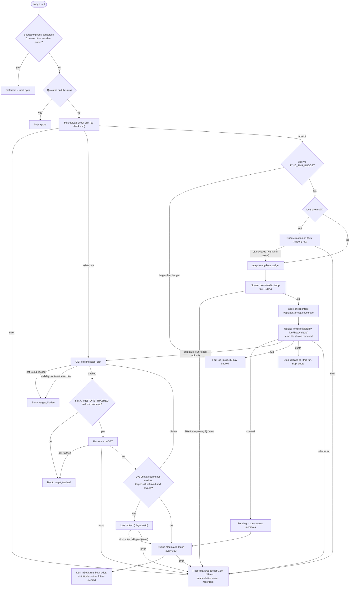
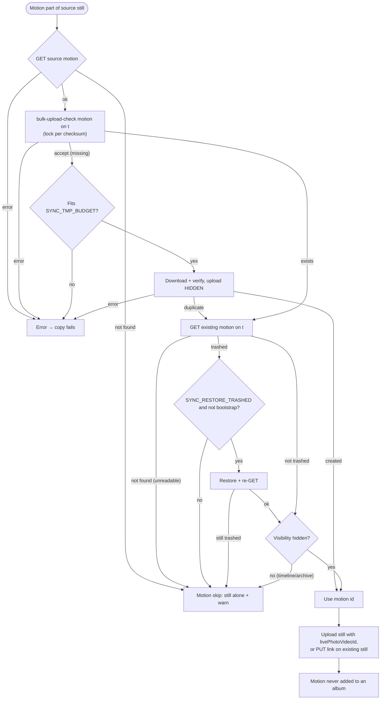
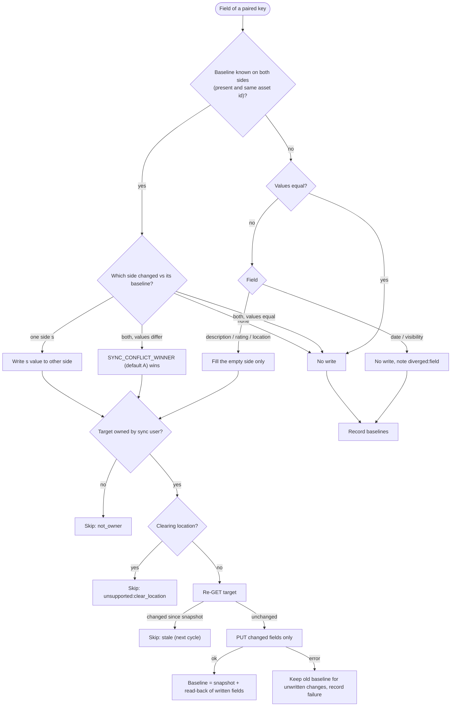
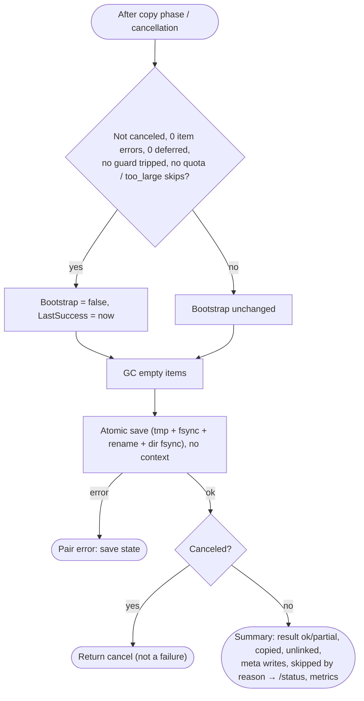

# Sync flow — every possibility in one sync period

Flow diagrams of what `immich-ferry run` does each `SYNC_INTERVAL`. They illustrate
[DESIGN.md](DESIGN.md) ("Sync algorithm", Appendix D); when the two disagree, DESIGN.md and the code win.
Code anchors: `internal/daemon/daemon.go` (loop), `internal/engine/discover.go`, `internal/engine/run.go`
(cycle), `internal/engine/planner/` (truth table), `probe.go`, `copy.go`, `livephoto.go`, `metadata.go`, `albuminfo.go`.

Diagrams:

1. [Daemon cycle](#1-daemon-cycle)
2. [Album discovery](#2-album-discovery-sync_discovery--allmarker)
3. [Pair run](#3-pair-run-runpair)
4. [Per-key decision (planner)](#4-per-key-decision-planner)
5. [Removal probe](#5-removal-probe-per-candidate)
6. [Copy one asset](#6-copy-one-asset)
7. [Metadata merge per field](#7-metadata-merge-per-field)
8. [End of pair run](#8-end-of-pair-run-state-and-result)

## 1. Daemon cycle

## 2. Album discovery (`SYNC_DISCOVERY` = all|marker)

Runs once per cycle after preflight. Selected = role owner/editor AND (mode `all` OR description contains
`SYNC_DISCOVERY_MARKER` on either side).

## 3. Pair run (`RunPair`)

Phase order: preflight → markers → state → albums → snapshot → plan → removals → metadata → album info → copies → save.

## 4. Per-key decision (planner)

`inA`/`inB` = key in the album snapshot of that side; `inS` = key was in both albums after the last success
(`Item.InBoth`). Pure function: no IO, never mutates state.

## 5. Removal probe (per candidate)

Probe runs on the side where the key vanished. Any doubt → no unlink. Assets are never deleted or trashed;
an unlink only removes the asset from the other album.

## 6. Copy one asset

### 6b. Live-photo motion

Motion skips (warn, still copied/linked alone) are not failures; other errors fail the copy.

## 7. Metadata merge per field

Fields: description, date + UTC offset, location (lat/lon), rating, visibility (timeline|archive only).
Favorites are never synced. Baselines are per side and bound to the asset id.

Album info (name, description) uses the same rules with album-level baselines; without a baseline only an
empty description is filled, never a rename.

## 8. End of pair run: state and result

